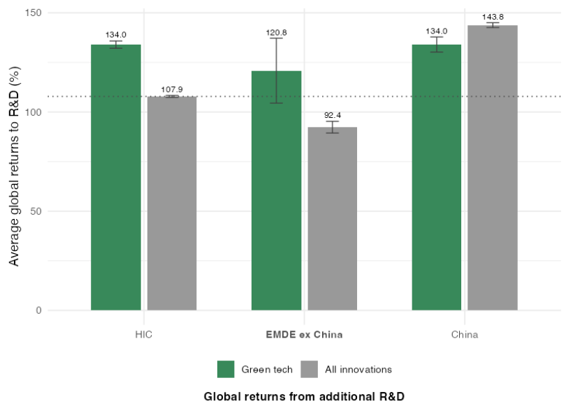

```{r setup}
library(data.table)
library(ggplot2)
library(scales)
library(maps)

ink    <- "#1d1d1d"
accent <- "#00538a"   # World Bank blue
warm   <- "#e07b39"
muted  <- "#8a8a8a"

theme_slides <- theme_minimal(base_size = 20) +
  theme(panel.grid.minor = element_blank(),
        panel.grid.major.x = element_blank(),
        plot.title = element_text(face = "bold", size = 20, colour = ink),
        plot.subtitle = element_text(colour = muted, size = 15),
        plot.caption = element_text(colour = muted, size = 11, hjust = 0),
        axis.title = element_text(colour = muted, size = 15),
        legend.position = "top")

ppi <- fread("data/ppi_power_generation.csv")
# Greenfield private solar & wind projects in low- and middle-income countries
sw <- ppi[sw == 1 & ppitype == "Greenfield project"]
```

## One group, five institutions {.smaller}

:::: {.columns}
::: {.column width="50%"}
### "The World Bank" — lends to governments

- **IBRD** — middle-income countries, market-rate loans
- **IDA** — the poorest ~75 countries, grants and near-zero-interest credits
:::

::: {.column width="50%"}
### The rest of the World Bank Group

- **IFC** — invests in the **private sector**: loans, equity, mobilising other investors *(where I worked)*
- **MIGA** — political-risk insurance and guarantees
- **ICSID** — investment dispute settlement
:::
::::

<br>

::: {.callout}
189 member countries. Finance raised by borrowing on capital markets against members' capital, then lent on to developing countries.
:::

::: notes
- "World Bank" in the narrow sense = IBRD + IDA: governments borrow for roads, power grids, schools, policy reforms.
- IFC is the private-sector arm. It doesn't lend to governments; it puts money into firms and projects, often as the first serious investor, and brings in commercial banks alongside.
- I'll talk about the Group as a whole; my own work was at IFC.
:::

## Mission: poverty *on a livable planet*

<br>

> **"To end extreme poverty and boost shared prosperity on a livable planet."**
>
> — World Bank Group mission, adopted 2023 (the "Evolution Roadmap")

<br>

:::: {.columns}
::: {.column width="33%"}
#### Why climate is in it
The poor are hit first and hardest — floods, droughts, heat, crop failure.
:::
::: {.column width="33%"}
#### Development needs energy
Hundreds of millions still lack electricity. The question is *which* energy.
:::
::: {.column width="33%"}
#### Mainstreamed, not a silo
In FY25, **97%** of World Bank projects had a climate component.
:::
::::

::: notes
- Before 2023 the mission was poverty and shared prosperity; "livable planet" was added explicitly.
- Climate is not a separate department; it's tracked as "co-benefits" across all lending (a road built to survive floods counts as adaptation).
- Two halves: mitigation (cut emissions — e.g. solar, grids) and adaptation (cope with impacts — e.g. flood defences, drought-resistant agriculture).
:::

## The largest climate financier of developing countries

:::: {.columns}
::: {.column width="58%"}
```{r cf, fig.width=7.2, fig.height=5}
cf <- data.table(fy = paste0("FY", 21:25),
                 climate = c(21.2, 26.2, 29.4, 31.0, 39.2),
                 share   = c(.32, .37, .40, .45, .49))
ggplot(cf, aes(fy, climate)) +
  geom_col(fill = accent, width = .62) +
  geom_text(aes(label = paste0("$", climate, "bn")), vjust = -.5, size = 6, colour = ink) +
  geom_text(aes(y = 2.2, label = percent(share)), colour = "white", size = 5.5, fontface = "bold") +
  scale_y_continuous(expand = expansion(mult = c(0, .12)), labels = NULL) +
  labs(x = NULL, y = NULL,
       title = "World Bank (IBRD + IDA) climate finance",
       subtitle = "US$ billion; white figure = share of all lending",
       caption = "Source: World Bank FY25 Climate-Related Disclosures.") +
  theme_slides + theme(panel.grid.major.y = element_blank())
```
:::

::: {.column width="42%"}
::: {.bignum}
$50.8bn
:::
Group-wide climate finance in FY25

- IBRD $22.5bn · IDA $16.7bn
- IFC $8.1bn · MIGA $3.5bn

::: {.bignum .small}
$190bn
:::
over FY21–25

In the poorest (IDA) countries, **over half** goes to **adaptation**.
:::
::::

::: notes
- The target was 35% of lending for climate over 2021–25, raised in 2023 to 45% by FY25 — and it reached 48–49%.
- The WBG on its own accounts for roughly half of all multilateral development bank climate finance. All MDBs together: record $163bn in 2025, $103bn of it in low- and middle-income countries.
- IDA FY25: 53% adaptation; IBRD: 34% adaptation.
:::

## Where the climate money goes

```{r dept}
dept <- data.table(
  dept = c("Agriculture and Food", "Digital Development", "Education", "Energy and Extractives",
           "Environment & Blue Economy", "Finance, Competitiveness & Innovation", "Governance",
           "Health, Nutrition & Population", "Macroeconomics, Trade & Investment", "Poverty and Equity",
           "Social Protection and Jobs", "Social Sustainability & Inclusion", "Transport",
           "Urban, Resilience & Land", "Water"),
  adaptation = c(835, 118, 392, 1055, 360, 1589, 296, 1066, 1150, 25, 1340, 343, 3697, 2717, 1627),
  mitigation = c(781, 202, 477, 5914, 906, 1068, 211, 1034, 4648, 268, 101, 126, 3855, 1283, 1693))
grp <- c("Agriculture and Food" = "Agriculture, food & environment",
         "Environment & Blue Economy" = "Agriculture, food & environment",
         "Energy and Extractives" = "Energy",
         "Transport" = "Transport",
         "Macroeconomics, Trade & Investment" = "Policy loans (macro & fiscal reform)",
         "Urban, Resilience & Land" = "Cities, resilience & land",
         "Water" = "Water",
         "Finance, Competitiveness & Innovation" = "Finance & private sector")
dept[, group := fifelse(dept %in% names(grp), grp[dept], "Health, education, social & other")]
g <- dept[, .(Adaptation = sum(adaptation) / 1e3, Mitigation = sum(mitigation) / 1e3), by = group]
g[, total := Adaptation + Mitigation]
g[, group := factor(group, g[order(total), group])]
gl <- melt(g, id.vars = c("group", "total"), variable.name = "type")
tot <- sum(g$total)
```

```{r dept-plot, fig.width=12.5, fig.height=5.3}
ggplot(gl, aes(value, group, fill = type)) +
  geom_col(width = .7) +
  geom_text(data = g, aes(total, group, label = paste0("$", round(total, 1), "bn  (", percent(total / tot, 1), ")")),
            inherit.aes = FALSE, hjust = -0.08, size = 5.5, colour = ink) +
  scale_fill_manual(values = c(Adaptation = "#7ab8b0", Mitigation = accent), name = NULL) +
  scale_x_continuous(labels = NULL, expand = expansion(mult = c(0, .32))) +
  labs(x = NULL, y = NULL,
       title = sprintf("World Bank (IBRD + IDA) climate finance, FY25: $%.1fbn by department", tot),
       caption = "Source: World Bank, Climate Finance 2025 (project-level data). Grouped by the Bank department running the project, not by sector:\ne.g. energy reforms inside budget-support (policy) loans count under Macroeconomics. Excludes IFC and MIGA.") +
  theme_slides + theme(panel.grid.major = element_blank(), axis.text.y = element_text(size = 17),
                       plot.title.position = "plot", plot.caption.position = "plot")
```

::: notes
- Energy is the single biggest mitigation item ($5.9bn of $22.6bn mitigation), but at ~18% of the total it is not the bulk: transport is as large, and adaptation-heavy areas (cities, water, agriculture, social protection) add up.
- "Policy loans" are budget-support operations (Development Policy Financing) whose reforms count as climate finance — e.g. cutting fossil-fuel subsidies, renewable auctions, carbon pricing. A fair share of that is clean-energy related too.
- So "clean energy" is roughly a fifth to a quarter of World Bank climate finance, depending on how you count policy loans.
- Excludes IFC ($8.1bn) and MIGA ($3.5bn), where renewables and green credit lines via banks dominate.
:::

## A pioneer in clean power markets

```{r ppi-prep}
sw[, period := cut(year, c(2004, 2010, 2015, 2020, 2024),
                   labels = c("2005-10", "2011-15", "2016-20", "2021-24"))]
by_year <- sw[year >= 2005, .(inv = sum(inv) / 1e3,
                              inv_wbg = sum(inv[wbg == 1]) / 1e3), by = year]
by_per  <- sw[!is.na(period), .(wbg_share = sum(inv[wbg == 1]) / sum(inv),
                                mdb_share = sum(inv[mdb == 1]) / sum(inv)), by = period]

# Each country's first year with a private solar/wind project vs later projects
single <- sw[!grepl(",", country)]
single[, first := year == min(year), by = country]
firsts <- single[, .(wbg = mean(wbg), mdb = mean(mdb)), by = first]
```

:::: {.columns}
::: {.column width="62%"}
```{r ppi-plot, fig.width=7.6, fig.height=5}
by_year[, other := inv - inv_wbg]
yl <- melt(by_year, id.vars = "year", measure.vars = c("other", "inv_wbg"))
yl[, variable := factor(variable, c("other", "inv_wbg"),
                        c("Other private projects", "With World Bank Group participation"))]
ggplot(yl, aes(year, value, fill = variable)) +
  geom_col(width = .8) +
  scale_fill_manual(values = c(muted, accent), name = NULL) +
  scale_y_continuous(labels = label_dollar(suffix = "bn"), expand = expansion(mult = c(0, .05))) +
  labs(x = NULL, y = NULL,
       title = "Private solar & wind investment",
       subtitle = "Low- & middle-income countries; greenfield projects, US$ billion",
       caption = "Source: World Bank PPI database; own calculations. WBG = IFC, MIGA, IBRD or IDA support.") +
  theme_slides + theme(legend.text = element_text(size = 14))
```
:::

::: {.column width="38%"}
**From ~$1bn a year in the mid-2000s to $34bn in 2024.**

WBG share of that investment:

```{r ppi-table}
knitr::kable(by_per[order(period), .(Period = period, `WBG share` = percent(wbg_share, 1),
                        `Any MDB` = percent(mdb_share, 1))], align = "lrr")
```

A country's **first** private solar/wind deals were **twice as likely** to have multilateral backing as its later deals (`r percent(firsts[first == TRUE, mdb])` vs `r percent(firsts[first == FALSE, mdb])`).
:::
::::

::: notes
- The story is market creation: when almost nobody would finance solar or wind in a developing country, IFC/MIGA/World Bank took first-of-a-kind risk (e.g. early wind in Sri Lanka and Pakistan, Scaling Solar in Zambia).
- Once the first projects prove the model, commercial money follows — and the WBG share falls. 2024: only ~2% of investment had WBG participation. That is a sign of success, not retreat.
- Caveat: PPI covers projects with private participation only — not purely state-owned utility investment (e.g. most of China's).
:::

## My work: innovation in green technologies {.smaller}

:::: {.columns}
::: {.column width="44%"}
**IFC Insights Report (2025): *Innovation in Green Technologies***

- Developing countries (ex China) produce **< 1%** of global green innovation…
- …but extra green R&D there has **high returns**: above average innovation in rich countries

**My hypothesis:** developing countries need *more* of their own innovation —

a. **for growth** — new technology waves (electronics in Korea and Taiwan, green tech in China) are how countries catch up

b. **for climate solutions that fit** — technologies for local climate, conditions and adaptation needs that rich-country R&D won't prioritise
:::

::: {.column width="56%" .center-col}
{width="84%"}

[Global returns to extra R&D, multi-country patents 2013–22; dotted line = average across all innovations. [Interactive version](https://mondpanther.github.io/kevceinsights/green-technology-innovation.html) · [IFC report](https://www.ifc.org/en/insights-reports/2025/innovation-in-green-technologies)]{.cite}

{width="80"}
:::
::::

::: notes
- Figure: estimated global returns to an extra unit of R&D — green R&D in EMDE ex China ~121% vs 92% for all EMDE innovation and 108% for the average innovation overall.
- Tech transfer alone isn't enough: imported technology is designed for rich-country conditions and prices.
- Green tech is a new field where incumbents' lead is smaller, so it's a window for developing countries.
- Development finance has largely funded deployment (building solar farms); much less goes to R&D and innovation capability in developing countries.
:::

## Why imported technology often doesn't fit {.smaller}

:::: {.columns}
::: {.column width="60%"}
```{r pests, fig.width=8, fig.height=4.5}
pests <- fread("data/gbif_pests.csv")
world <- as.data.table(map_data("world"))[region != "Antarctica"]
pests[, species := factor(species, c("Western corn rootworm (Diabrotica virgifera)",
                                     "African maize stalk borer (Busseola fusca)"))]
ggplot() +
  geom_polygon(data = world, aes(long, lat, group = group), fill = "#e9e9e4", colour = "white", linewidth = .15) +
  geom_point(data = pests[species %like% "rootworm"], aes(lon, lat, colour = species), size = 1.1, alpha = .5) +
  geom_point(data = pests[species %like% "stalk"], aes(lon, lat, colour = species), size = 2.4, alpha = .85) +
  scale_colour_manual(values = c(accent, warm), name = NULL) +
  guides(colour = guide_legend(ncol = 1, override.aes = list(size = 4, alpha = 1))) +
  coord_quickmap(ylim = c(-40, 65), expand = FALSE) +
  labs(title = "Two maize pests, two different worlds",
       subtitle = "Recorded occurrences",
       caption = "Source: GBIF.org occurrence records (accessed Nov 2026).") +
  theme_void(base_size = 18) +
  theme(legend.position = "top", legend.justification = "left", legend.text = element_text(size = 15),
        plot.title = element_text(face = "bold", size = 19), plot.subtitle = element_text(colour = muted, size = 14),
        plot.caption = element_text(colour = muted, size = 11, hjust = 0), plot.title.position = "plot")
```
:::

::: {.column width="40%"}
**Maize is attacked by different pests in different places.**

- **US/Europe:** western corn rootworm (~\$1bn a year in US losses) — a prime target of R&D, e.g. Bt maize
- **Sub-Saharan Africa:** African maize stalk borer destroys ~**10% of Kenya's maize** every year — absent from the US, and Bt maize works less well against it

R&D follows rich-country problems: patents on pests present in the US outnumber those on other pests **more than 5 to 1**.

Climate change shifts pests, diseases and growing conditions — so the mismatch matters more.

[Moscona & Sastry, *Inappropriate Technology: Evidence from Global Agriculture*, NBER WP 33500]{.cite}
:::
::::

::: notes
- Moscona & Sastry measure "pest mismatch" between countries using CABI data on ~5,000 crop pests and pathogens. Mismatch with the technology frontier (US/Western Europe) cuts transfer of crop varieties by ~30% and lowers output; their (deliberately extreme) counterfactual puts the productivity loss from inappropriate technology at 58% of global agricultural productivity.
- Other examples of climate innovation built for developing-country conditions:
  - "Scuba rice" (Swarna-Sub1, IRRI): survives ~2 weeks under water. In Odisha, farmers who got it also invested more (fertiliser, land), so gains were roughly double the direct flood protection (Emerick, de Janvry, Sadoulet & Dar, AER 2016).
  - Drought-tolerant maize varieties bred for Africa (CIMMYT).
  - Pay-as-you-go solar irrigation pumps for smallholders (e.g. in Kenya).
:::

## New: who does innovation in developing countries?

:::: {.columns}
::: {.column width="50%" .center-col}
#### New paper — CEP DP 2223 (Oct 2026)
*Innovation partnerships for development along green value chains*

{width="220"}

Partnerships with rich-country firms account for **~2%** of rich-country innovation but **almost half** of developing-country innovation — and produce the highest-value innovations.
:::

::: {.column width="50%" .center-col}
#### EMDERLT — Research Lab Tracker
*Map of ~2,000 verified R&D labs in developing countries*

{width="220"}

Who invents what, where — free to explore and download.
:::
::::

::: {.thanks}
Questions?
:::

::: notes
- Policy implications: R&D tax incentives in developing countries; development banks co-investing in R&D partnerships and labs — not just in deployment.
- Links: cep.lse.ac.uk DP2223; mondpanther.github.io/kevceinsights/mnc-rd-labs-map.html

Q&A prep:
- "What about Trump / the US?" — In June 2026 the Bank dropped its 45% climate-finance target under US pressure; the climate action plan was extended. Climate projects continue, but there's no headline target.
- "Does the Bank still fund fossil fuels?" — It stopped financing upstream oil & gas from 2019; in 2025 it lifted its ban on financing nuclear power and opened the door to upstream gas ("all of the above" energy).
:::
